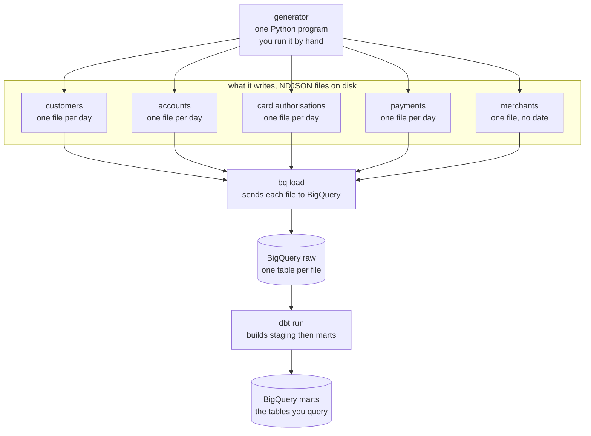
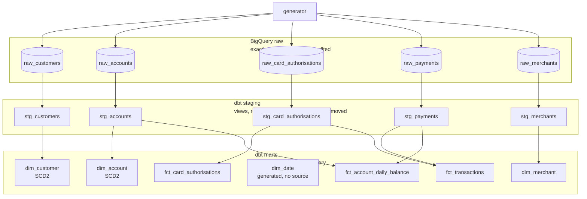
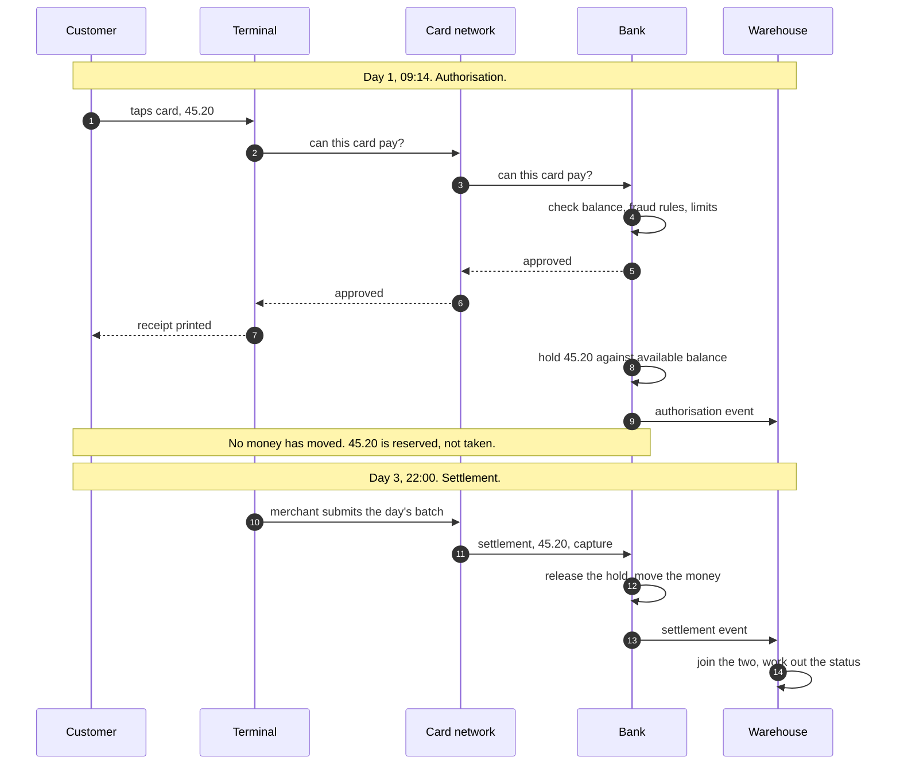

# Architecture

Three diagrams. The first shows what runs and in what order. The second shows every table and
where it comes from. The third shows the card payment lifecycle, which is the thing that makes the
modelling awkward.

All are written in Mermaid, which GitHub renders in the browser.

## What actually runs

There are no real backend services here. One Python program stands in for all of them, writing
files that look like what a bank's services would send.

Three things you run, in order:

1. `python generator/...` writes the files
2. `bq load` puts them in BigQuery
3. `dbt run` builds everything on top

Only step 1 exists so far, and only the merchants part of it.

## Every table and where it comes from

Same pipeline, now showing each table rather than each step.

Worth noticing:

**Raw to staging is one to one.** Five tables in, five out. Staging only tidies, it never combines.

**Staging to marts is not.** Five go in, seven come out, and some cross over. This is where the
shape changes.

**`fct_transactions` has two arrows into it.** It needs authorisations and settlements both,
because transaction status is worked out by checking whether a settlement arrived. No source sends
that column.

**`dim_date` has no arrow in.** It is generated from a date range, because nothing upstream emits
a calendar.

## Card payment lifecycle

One card tap produces two events, days apart, possibly for different amounts. This is why
`fct_transactions` needs two sources.

### Why this causes problems

**Authorisation is not spend.** A hold can be released without money ever moving, if the merchant
abandons it or it expires. Reporting spend from authorisations overstates it.

**Settlement can differ from authorisation.** A restaurant authorises 40.00 and settles 48.00 once
a tip is added. A pay at pump petrol station authorises 100.00 and settles 62.00. Card networks
allow settlement above the authorised amount by roughly twenty percent, so a test asserting
settlement never exceeds authorisation would fail on every tipped meal.

**Status is derived, not sent.** Nothing upstream knows whether a transaction is pending or
settled, because that depends on whether a second event has turned up yet.

| Authorisation | Settlement | Status |
|---|---|---|
| exists | none yet | pending |
| exists | capture | settled |
| exists | capture then refund | reversed |

**Two timestamps are needed.** `created_ts` is when it happened, `ingested_ts` is when the
warehouse received it. A transaction at 23:50 on 31 March arriving at 00:30 on 2 April counts as
March by the first and April by the second. Both are correct, for different questions.

## Why three layers

**raw** holds exactly what arrived and is never edited. If a transformation turns out to be wrong,
everything downstream is rebuilt from here rather than asking the source systems to send it again.

**staging** renames columns, fixes types, and removes duplicate deliveries. One model per source,
no business logic, nothing joined.

**marts** is where the shape changes: sources get combined, columns get derived, and the result is
organised around the questions people ask rather than around the systems the data came from.

Each layer has one job, so when something breaks it is clear which part to look at.
