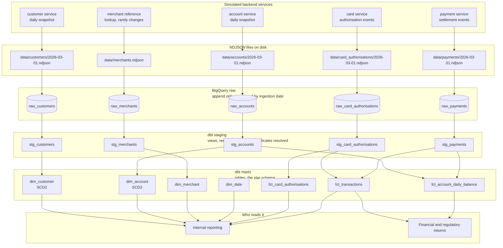
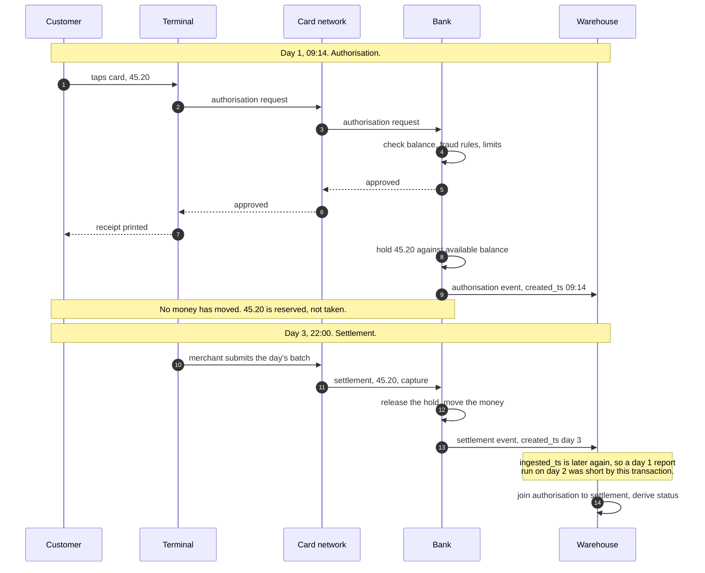
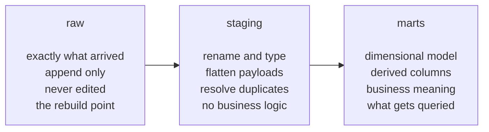

# Architecture

Two views of the same system. The flow diagram shows where data goes. The sequence diagram shows
the card payment lifecycle that makes the modelling awkward.

Both are written in Mermaid, which GitHub renders directly in the browser.

## Data flow

Things worth noticing in that diagram.

**Raw is never read by anything except staging.** If a transformation turns out to be wrong, the
warehouse is rebuilt from raw without going back to the source systems.

**`fct_transactions` has two inputs.** It needs both the authorisation and the settlement, because
transaction status is derived from whether a settlement arrived. No source sends that column.

**`dim_date` has no input.** It is generated from a date range rather than loaded from anywhere,
since nothing upstream emits a calendar.

## Card payment lifecycle

This is the sequence that makes the modelling interesting. One card tap produces two events, days
apart, possibly with different amounts.

### Why this shape causes problems

**Authorisation is not spend.** The hold can be released without any money moving, if the merchant
abandons the authorisation or it expires. Reporting spend from authorisations overstates it.

**Settlement can differ from authorisation.** A restaurant authorises 40.00 and settles 48.00 once
a tip is added. A pay at pump petrol station authorises 100.00 and settles 62.00. The card networks
allow settlement above the authorised amount within a tolerance of roughly twenty percent, so a
test asserting that settlement never exceeds authorisation would fail on every tipped meal.

**Status is derived, not sent.** Nothing upstream knows whether a transaction is pending or
settled, because that depends on whether a second event has turned up yet.

| Authorisation | Settlement | Status |
|---|---|---|
| exists | none yet | pending |
| exists | capture | settled |
| exists | capture then refund | reversed |

**Two timestamps are needed.** `created_ts` says when it happened, `ingested_ts` says when the
warehouse received it. A transaction at 23:50 on 31 March arriving at 00:30 on 2 April belongs in
March by the first and April by the second. Both answers are correct, for different questions, and
reproducing what a past report said needs both.

## Layer responsibilities

Each layer has one job. Keeping them separate means source specific awkwardness is handled in
exactly one place, and everything downstream can assume clean, consistently named input.
