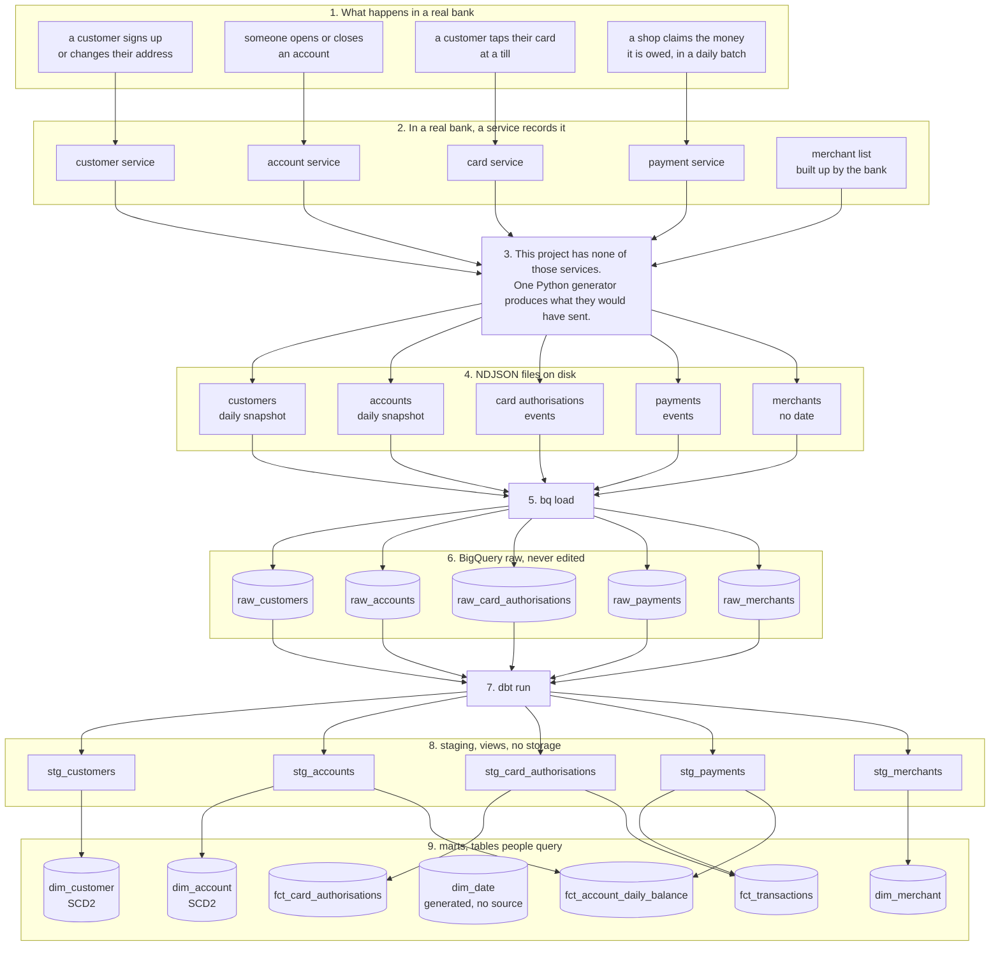
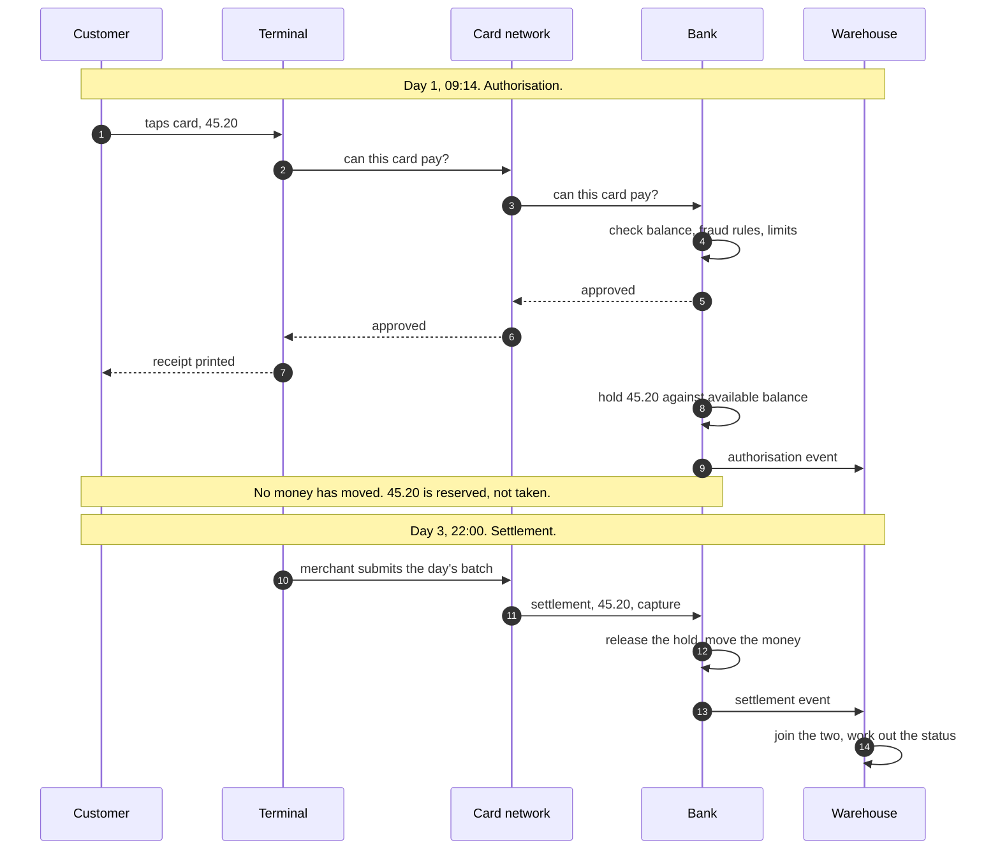

# Architecture

Two diagrams. The first shows the whole pipeline, from something happening in a bank through to
the tables people query. The second shows the card payment lifecycle, which is the thing that
makes the modelling awkward.

All are written in Mermaid, which GitHub renders in the browser.

## What actually runs

In a real bank, data appears because people do things. Someone taps a card, someone opens an
account, a shop claims its money. Backend services record each of those.

There are no real people here and no real services. One Python program stands in for the lot,
writing files that look like what those services would have sent.

Steps 3 and 4 happen on a laptop. Everything from step 5 onwards is BigQuery, which is the only
cloud service this project uses.

| Step | What happens | What runs it |
|---|---|---|
| 1 | a customer taps a card, signs up, opens an account, or a shop claims its money | the real world |
| 2 | the service that owns that area records it | a real bank. This project has none |
| 3 | one Python generator produces what those services would have sent | a laptop |
| 4 | the generator writes files. Customer and account write a full daily snapshot, card and payment write one line per event | a laptop |
| 5 | `bq load` sends each file over | a BigQuery **load job**, reading the file and writing into storage |
| 6 | raw tables, exactly what arrived, never edited | BigQuery **storage**. Partitioning is a storage feature, it decides the physical layout |
| 7 | `dbt run` builds everything above raw | BigQuery **query jobs**. The SQL runs on Google's machines, not the laptop |
| 8 | staging views rename, type and remove duplicates | **metadata only**. A view is a saved query, so it takes no storage |
| 9 | marts, the tables people query | BigQuery **storage**, written by the query jobs that built them |

Every operation is recorded as a job, and `INFORMATION_SCHEMA.JOBS` holds a row for each one. The
`query-comment` setting in `dbt_project.yml` labels each job with the model that produced it, so
usage can later be attributed per model rather than appearing as one anonymous total.

Three things you run, in order:

1. `python generator/generate.py` writes the files
2. `bq load` puts them in BigQuery
3. `dbt run` builds everything on top

Worth noticing:

**Raw to staging is one to one.** Five tables in, five out. Staging only tidies, it never combines.

**Staging to marts is not.** Five go in, seven come out, and some cross over. This is where the
shape changes.

**`fct_transactions` has two arrows into it.** It needs authorisations and settlements both,
because transaction status is worked out by checking whether a settlement arrived. No source sends
that column.

**`dim_date` has no arrow in.** It is generated from a date range, because nothing upstream emits
a calendar.

## Card payment lifecycle

One card tap produces two events, days apart, possibly for different amounts. This is why
`fct_transactions` needs two sources.

### Why this causes problems

**Authorisation is not spend.** A hold can be released without money ever moving, if the merchant
abandons it or it expires. Reporting spend from authorisations overstates it.

**Settlement can differ from authorisation.** A restaurant authorises 40.00 and settles 48.00 once
a tip is added. A pay at pump petrol station authorises 100.00 and settles 62.00. Card networks
allow settlement above the authorised amount by roughly twenty percent, so a test asserting
settlement never exceeds authorisation would fail on every tipped meal.

**Status is derived, not sent.** Nothing upstream knows whether a transaction is pending or
settled, because that depends on whether a second event has turned up yet.

| Authorisation | Settlement | Status |
|---|---|---|
| exists | none yet | pending |
| exists | capture | settled |
| exists | capture then refund | reversed |

**Two timestamps are needed.** `created_ts` is when it happened, `ingested_ts` is when the
warehouse received it. A transaction at 23:50 on 31 March arriving at 00:30 on 2 April counts as
March by the first and April by the second. Both are correct, for different questions.

## Why three layers

**raw** holds exactly what arrived and is never edited. If a transformation turns out to be wrong,
everything downstream is rebuilt from here rather than asking the source systems to send it again.

**staging** renames columns, fixes types, and removes duplicate deliveries. One model per source,
no business logic, nothing joined.

**marts** is where the shape changes: sources get combined, columns get derived, and the result is
organised around the questions people ask rather than around the systems the data came from.

Each layer has one job, so when something breaks it is clear which part to look at.
